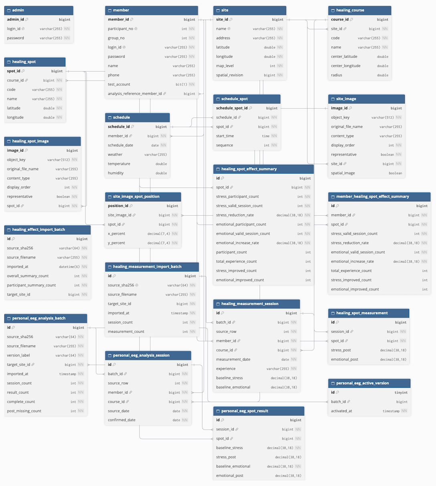

# Therapeutic Garden

**Therapeutic Garden**은 현대건설 공동주택 현장에서 진행되는 헬스케어 실증의 운영과 데이터 관리를 지원하기 위해 개발한 **Spring Boot 기반 웹 애플리케이션**입니다.

관리자와 참가자의 일정 관리부터 치유 공간 정보, 이미지 및 공간 배치, 뇌파 측정 결과 분석까지 실증 운영에 필요한 기능을 제공합니다.

관리자는 참가자와 일정을 관리하고, 실증 장소와 측정 결과를 모니터링할 수 있습니다. 참가자는 본인의 방문 일정과 치유 공간 정보, 측정 결과를 확인할 수 있습니다.

현재 Railway를 통해 웹서비스를 배포·운영하고 있으며, 일부 데이터 분석 기능은 관련 데이터베이스 스키마와 측정 데이터의 준비 상태에 따라 제공 범위가 달라집니다.

---

## 1. 주요 기능

### 관리자

**계정 및 참가자 관리**
- 관리자 로그인 및 비밀번호 변경
- 참가자 등록, 조회, 수정, 삭제
- 참가자 비밀번호 재설정
- 관리자 및 참가자 접근 권한 구분

**일정 관리**
- 참가자별 일정 등록, 조회, 수정, 삭제
- FullCalendar 기반 월간 일정 조회
- 일정별 Healing Spot 및 방문 시간 관리
- 일정 날짜에 따른 날씨 정보 조회
- 일정 중복 및 입력값 검증

**치유 공간 관리**
- Site 등록, 조회, 수정, 삭제
- Site별 Healing Course(HC) 관리
- Healing Course별 Healing Spot(HS) 관리
- Kakao Maps 기반 공간 위치 표시
- Site 및 Healing Spot 이미지 업로드와 관리
- 대표 이미지 지정 및 이미지 표시 순서 변경
- 공간 이미지 위 Healing Spot 위치 설정

**Monitoring 및 데이터 분석**
- Site 및 참가자별 Monitoring
- Healing Spot별 스트레스·정서적 안정성 변화 조회
- 참가자별 측정 결과 및 개선 경향 확인
- 측정 데이터 기반 그래프와 분석 결과 표시

### 참가자

**계정 및 일정**
- 참가자 로그인 및 로그아웃
- 마이페이지 및 비밀번호 변경
- 본인 일정 등록, 조회, 수정, 삭제
- FullCalendar 기반 개인 일정 확인
- 일정별 방문 장소와 Healing Spot 상세 정보 확인

**공간 및 측정 결과**
- Site 및 Healing Spot 정보 조회
- 공간 이미지와 Healing Spot 위치 확인
- 본인 측정 기록 조회
- 스트레스·정서적 안정성 변화 그래프와 표 확인
- 개인별 분석 결과 확인

참가자 데이터는 로그인한 사용자와 접근 권한을 기준으로 제한합니다.

---

## 2. 데이터 분석 기능

실증 과정에서 수집한 측정 데이터를 바탕으로 치유 공간별 변화 경향을 확인할 수 있도록 구성했습니다.

### Healing Effect 분석

Healing Spot 단위로 스트레스 감소와 정서적 안정성 증가에 관한 분석 결과를 제공합니다.

- 전체 참가자의 Healing Spot별 집계 결과
- 개별 참가자의 Healing Spot별 집계 결과
- 유효 측정 횟수 및 참가자 수 관리
- 개선율과 개선 인원 관련 지표 조회
- 관리자 및 참가자 화면에서 결과 시각화

### Raw Measurement

측정 원자료를 별도로 관리하고 분석에 활용합니다.

- Excel 기반 측정 데이터 파싱
- 측정 세션 및 Spot별 결과 저장
- Baseline 및 Post 측정값 관리
- 입력 데이터 검증
- 명시적 CLI를 통한 데이터 Import 및 집계 재생성

### Personal EEG Analysis

개인별 분석 결과를 별도의 데이터 구조로 관리합니다.

- 개인 EEG 분석용 Excel 데이터 파싱
- 참가자·코스·Spot별 분석 결과 저장
- Baseline/Post 기반 측정 지표 관리
- Import Batch 및 버전 관리
- 활성 분석 버전 전환

**참고:** 데이터 분석 기능은 관련 테이블과 측정 데이터가 준비되어야 결과를 표시할 수 있습니다. 일부 화면은 데이터가 없는 경우 빈 상태를 표시하거나 기존 측정 이력으로 대체합니다.

개인 EEG 관련 테이블은 분석 지표를 저장하는 구조이며, EEG 대역별 원자료 전체나 보고서 파일 자체를 저장하는 구조는 아닙니다. 랜딩페이지의 보고서 미리보기는 예시 이미지입니다.

---

## 3. 기술 스택

### Backend

| 기술 | 사용 목적 |
|---|---|
| Java 21 | 애플리케이션 개발 |
| Spring Boot 4.1.0 | 애플리케이션 프레임워크 |
| Spring MVC | 웹 요청 및 응답 처리 |
| Spring Data JPA | 데이터 영속성 관리 |
| Spring Security | 비밀번호 인코딩 등 보안 기능 |
| MySQL | 애플리케이션 데이터 저장 |
| Apache POI 5.4.1 | Excel 데이터 파싱 |
| AWS SDK for Java 2.54.17 | S3 호환 이미지 스토리지 연동 |

Spring Security 및 Spring Data JPA의 세부 의존성 버전은 Spring Boot의 의존성 관리 설정을 따릅니다.

### Frontend

| 기술 | 사용 목적 |
|---|---|
| Thymeleaf | 서버 사이드 HTML 렌더링 |
| HTML / CSS / JavaScript | 웹 UI |
| FullCalendar 7.0.2 | 일정 달력 |
| Kakao Maps JavaScript SDK | 지도 및 공간 정보 시각화 |

### Build 및 Deployment

| 기술 | 사용 목적 |
|---|---|
| Gradle Wrapper 9.5.1 | 빌드 및 의존성 관리 |
| Railway | 웹 애플리케이션 배포 |
| MySQL | 운영 데이터베이스 |
| Local / S3 호환 Storage | 이미지 저장 |

### Test

- JUnit 기반 Java 단위·통합 테스트
- Spring MockMvc 기반 Controller 테스트
- H2 MySQL 호환 모드
- JavaScript 테스트 (`node:test`)
- 인증, 일정, 이미지, 데이터 분석 관련 회귀 테스트

---

## 4. 프로젝트 구조

```text
src/
├── main/
│   ├── java/com/example/manage/
│   │   ├── config/           # Spring Web, Security, Storage 설정
│   │   ├── controller/       # 관리자·참가자 웹 및 API Controller
│   │   ├── domain/           # JPA Entity
│   │   ├── dto/              # 요청·응답 및 화면 데이터 객체
│   │   ├── repository/       # 데이터 접근 계층
│   │   ├── service/          # 비즈니스 로직
│   │   ├── interceptor/      # 역할별 로그인·세션 접근 제어
│   │   ├── storage/          # 로컬 및 S3 호환 이미지 저장소
│   │   ├── healingeffect/    # 측정 데이터 Import·집계
│   │   ├── personaleeg/     # 개인 EEG 분석·버전 관리
│   │   ├── passwordreset/    # 보호된 계정 관리 CLI
│   │   ├── ManageApplication.java
│   │   └── ProductionDdlGuard.java
│   │
│   └── resources/
│       ├── templates/
│       │   ├── admin/        # 관리자 화면
│       │   ├── member/       # 참가자 화면
│       │   └── fragments/    # 공통 화면 조각
│       ├── static/
│       │   ├── css/
│       │   ├── js/
│       │   └── images/
│       └── META-INF/
│           └── spring.factories
│
└── test/
    ├── java/                # Java 단위·통합 테스트
    └── js/                  # JavaScript 테스트
```

전체 애플리케이션은 Controller, Service, Repository, Domain 계층을 중심으로 구성되어 있습니다.

이미지 저장소와 측정 데이터 Import 기능은 별도 패키지로 분리했으며, 운영 데이터에 영향을 줄 수 있는 CLI에는 대상 확인 및 실행 승인 절차를 적용합니다.

---

## 5. 데이터베이스 설계

데이터베이스는 총 **20개 테이블**을 기반으로 구성되어 있습니다.

### ERD



### 핵심 데이터 영역

| 영역 | 주요 테이블 |
|---|---|
| 계정 | `admin`, `member` |
| 치유 공간 | `site`, `healing_course`, `healing_spot` |
| 일정 | `schedule`, `schedule_spot` |
| 이미지·공간 배치 | `site_image`, `healing_spot_image`, `site_image_spot_position` |
| 효과 집계 | `healing_spot_effect_summary`, `member_healing_spot_effect_summary`, `healing_effect_import_batch` |
| 원시 측정 데이터 | `healing_measurement_import_batch`, `healing_measurement_session`, `healing_spot_measurement` |
| 개인 EEG 분석 | `personal_eeg_analysis_batch`, `personal_eeg_analysis_session`, `personal_eeg_spot_result`, `personal_eeg_active_version` |

### 주요 관계

- 하나의 Site는 여러 Healing Course를 가질 수 있습니다.
- 하나의 Healing Course는 여러 Healing Spot을 가질 수 있습니다.
- 하나의 참가자는 여러 일정을 등록할 수 있습니다.
- 일정과 Healing Spot은 `schedule_spot`을 통해 연결됩니다.
- Site 및 Healing Spot은 각각 이미지를 관리합니다.
- 공간 이미지와 Spot의 상대 좌표는 `site_image_spot_position`에 저장됩니다.
- 효과 집계 데이터는 Spot별·참가자별로 구분하여 관리합니다.
- Raw Measurement와 Personal EEG는 Import Batch 및 측정 세션을 중심으로 관리합니다.
- Personal EEG는 활성 분석 버전을 별도 테이블에서 관리합니다.

ERD는 프로젝트의 JPA Entity 및 스키마 SQL을 기반으로 작성한 설계 구조입니다. 실제 운영 DB에 적용된 모든 테이블·인덱스의 상태를 보증하는 자료는 아닙니다.

스키마 변경 시에는 해당 기능의 SQL 정의와 운영 적용 상태를 별도로 확인해야 합니다.

---

## 6. 인증 및 보안

관리자와 참가자는 각각의 로그인 경로와 역할에 따라 서비스에 접근합니다.

### 접근 제어

- 관리자·참가자 로그인 영역 분리
- Spring MVC Interceptor 기반 보호 URL 접근 제어
- 세션을 이용한 사용자 인증 상태 확인
- 사용자 역할 및 데이터 소유권 검증
- 인증되지 않은 API 요청과 화면 요청에 대한 구분된 응답

Spring Security는 비밀번호 인코딩 등의 기능에 사용하며, 현재 주요 웹 접근 제어는 Interceptor와 애플리케이션의 세션 검증 로직이 담당합니다.

### 세션 및 계정 보안

- BCrypt 기반 비밀번호 저장
- 로그인 시 세션 ID 변경
- 로그아웃 시 세션 무효화
- 비밀번호 변경 및 계정 삭제 후 기존 세션 검증
- 로그인 실패 횟수 제한
- 관리자·참가자 권한 구분

### 이미지 보안

- JPEG·PNG·WebP 파일 내용 검증
- 이미지 크기·형식 검증
- 객체 키 및 로컬 저장 경로 검증
- 업로드·교체·삭제 실패 시 복구 처리

---

## 7. 이미지 저장 구조

이미지 저장소는 설정에 따라 다음 모드 중 하나를 사용합니다.

| 모드 | 설명 |
|---|---|
| `disabled` | 이미지 저장 기능 비활성화 |
| `local` | 로컬 파일 시스템 사용 |
| `s3` | S3 호환 오브젝트 스토리지 사용 |

이미지 메타데이터는 데이터베이스에서 관리하며, 실제 파일은 선택한 저장소에 보관합니다.

Site 이미지와 Healing Spot 이미지는 별도로 관리하고, 대표 이미지·표시 순서·공간 이미지 좌표 등의 정보를 데이터베이스에서 처리합니다.

---

## 8. 로컬 실행

### 사전 요구사항

- JDK 21
- MySQL
- 프로젝트의 Gradle Wrapper
- 필요한 로컬 애플리케이션 설정
- Kakao Maps 사용을 위한 설정값

### 환경 설정

프로젝트 실행 전 로컬 데이터베이스 연결 정보와 필요한 설정값을 준비합니다.

주요 환경변수 이름은 다음과 같습니다.

```text
SPRING_PROFILES_ACTIVE
SPRING_DATASOURCE_URL
SPRING_DATASOURCE_USERNAME
SPRING_DATASOURCE_PASSWORD

KAKAO_MAPS_JAVASCRIPT_KEY
PORT

STORAGE_MODE
STORAGE_LOCAL_DIRECTORY
STORAGE_RECOVERY_DIRECTORY

BUCKET
ACCESS_KEY_ID
SECRET_ACCESS_KEY
REGION
ENDPOINT
```

실제 사용되는 설정은 활성 Spring 프로파일과 저장소 모드에 따라 달라집니다.

**주의:** 비밀번호, API 키, DB 연결 자격 증명 등은 README나 Git 저장소에 기록하지 마세요. 로컬 설정 파일에도 실제 자격 증명이 포함될 수 있으므로 Git 추적 여부를 확인해야 합니다.

### 실행

MySQL 및 로컬 설정을 준비한 뒤 다음 명령을 실행합니다.

```bash
./gradlew bootRun --args='--spring.profiles.active=local'
```

실행 후 기본 포트 기준으로 접속합니다.

```text
http://localhost:8080
```

로컬 프로파일의 데이터베이스는 H2 격리 테스트 DB가 아닐 수 있습니다. 기존 데이터베이스를 사용하는 경우에는 연결 대상을 확인한 뒤 실행하세요.

---

## 9. 테스트

Java 및 JavaScript 테스트를 통해 주요 기능의 회귀를 검증합니다.

### Java 컴파일

```bash
./gradlew compileJava
```

### Java 테스트

```bash
./gradlew test
```

기존 실데이터 의존 테스트 3개는 Apache POI로 합성 Excel 워크북을 생성합니다. 데이터베이스가 필요한 테스트는 격리된 H2 테스트 DB를 사용합니다.

### JavaScript 테스트

```bash
node --test src/test/js/*.test.js
```

### 회귀 검증 기록

2026년 10월 기준, `./gradlew test`로 전체 Java 테스트를 실행해 다음 결과를 확인했습니다.

| 구분 | 결과 |
|---|---|
| Java | 55개 클래스, 507개 테스트 통과 |
| JavaScript | 129개 테스트 통과 |
| 주요 검증 | 인증·세션·권한·일정·이미지·데이터 집계 |

Java와 JavaScript 모두 실패·건너뜀 0건입니다.

실제 운영 DB, S3 네트워크 및 모든 외부 연동에 대한 검증을 포함하는 결과는 아닙니다.

---

## 10. 운영 및 배포

애플리케이션은 Railway를 통해 운영 환경에 배포합니다.

운영 환경에서는 로컬과 다른 프로파일 및 연결 설정을 사용합니다.

### 운영 DB 보호

`ProductionDdlGuard`는 애플리케이션 시작 시 운영 관련 조건을 검사합니다.

Railway, 원격 MySQL 또는 운영 환경으로 판단되는 실행에서는 기존 보호 정책에 따라 다음 설정을 요구합니다.

- `prod` 프로파일 사용
- Hibernate `ddl-auto=validate`

운영 환경에서 Hibernate가 스키마를 임의로 변경하지 않도록 하기 위한 보호 장치입니다.

### 데이터 스키마 변경

측정 데이터, 개인 EEG 및 참가자 분석 관련 테이블은 별도의 SQL 정의와 적용 절차를 사용합니다.

**운영 DB에 스키마 SQL을 임의로 실행하거나 개발 환경의 자동 스키마 변경 설정을 적용하지 마세요.**

SQL 파일에 따라 기존 정의와 중복되는 컬럼이 있을 수 있으므로, 각 스키마 문서를 독립적으로 검토하고 현재 DB 상태를 확인해야 합니다.

### 배포 시 확인사항

- 배포 대상 Git 브랜치와 커밋
- Spring 프로파일
- DB 연결 및 스키마 상태
- 이미지 Storage 설정
- 애플리케이션 시작 로그
- 관리자·참가자 주요 화면
- 랜딩페이지 및 정적 리소스 표시

배포 및 운영 변경은 기존 서비스와 데이터 백업 상태를 확인한 후 진행합니다.

---

## 11. 프로젝트 문서

상세한 데이터 처리 및 운영 절차는 다음 문서를 참고하세요.

| 문서 | 설명 |
|---|---|
| [코드 스타일 가이드](docs/CODE_STYLE.md) | Java 및 프로젝트 코드 스타일 기준 |
| [Healing Effect 스키마](docs/healing-effect-schema.sql) | 효과 집계 관련 스키마 |
| [Healing Improvement 스키마](docs/healing-improvement-schema.sql) | 개선 지표 관련 스키마 정의 |
| [측정 데이터 감사](docs/healing-measurement-audit.md) | 측정 데이터 분석 및 검증 |
| [개인 EEG 통합 안내](docs/personal-eeg-integration.md) | 개인 EEG 데이터 구조 및 Import·버전 관리 |
| [참가자 비밀번호 재설정](docs/participant-password-reset.md) | 비밀번호 재설정 CLI 안전 실행 절차 |
| [TEST004 스키마](docs/test004-schema.sql) | 테스트 참가자 관련 스키마 |
| [운영 사전 점검](docs/test004-production-preflight.md) | 운영 반영 전 확인 절차 |

운영용 CLI 및 데이터 Import 작업은 해당 문서의 사전 검증·승인 절차를 확인한 뒤 수행해야 합니다.

---

## 12. 개발 및 운영 시 주의사항

- 실제 참가자 개인정보 및 측정 원본 파일을 Git에 포함하지 않습니다.
- 운영 DB의 백업·복구 절차를 확인하지 않은 상태에서 스키마를 변경하지 않습니다.
- 운영 데이터에 영향을 주는 Import·Rebuild·비밀번호 재설정 CLI는 별도의 안전 실행 절차를 따릅니다.
- 테스트 실행 시 실제 참가자 데이터와 운영 서비스 접근 여부를 먼저 확인합니다.
- README의 ERD는 설계 기준 자료이며, 실제 운영 스키마와의 일치 여부는 별도 확인이 필요합니다.

---

Therapeutic Garden은 치유 공간의 운영 정보와 측정 데이터를 통합 관리하고, 관리자와 참가자가 실증 결과를 확인할 수 있도록 지원하는 웹서비스입니다.
